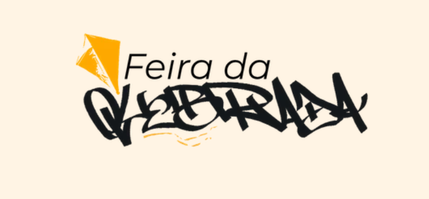

### Conectando quem empreende na quebrada a quem mora nela 🪁

---

## 👋 Quem somos

A **Feira da Quebrada** é uma plataforma digital que dá visibilidade a pequenos comerciantes e empreendedores locais e ajuda moradores a encontrar produtos e serviços perto de onde vivem.

Somos a turma **SP09** do curso de **Front End do Instituto Proa**, em parceria com a **Serasa Experian**, e esta é a nossa vitrine para o Projeto Integrador.

## 💡 O problema que resolvemos

Muitos pequenos negócios dependem só das redes sociais e têm dificuldade de alcançar clientes novos da própria região. Do outro lado, os moradores nem sempre sabem quais comércios e serviços existem perto deles.

> A Fernanda, trancista que atende no fundo de casa, é a persona que inspirou o projeto: talento de sobra, mas pouca forma de ser encontrada por quem está procurando.

## ✨ O que a plataforma oferece

| | |
|---|---|
| 🔎 **Busca** | Por nome do comércio, serviço ou produto |
| 🗂️ **Filtros** | Por região e por categoria (alimentação, estética, moda, tatuagem, costura, serviços...) |
| 👤 **Perfil do empreendedor** | Foto, descrição, serviços e redes sociais |
| 🗺️ **Mapa por região** | Mostra a região do negócio, **sem expor o endereço exato** |

**Diferenciais:** foco no pequeno empreendedor, privacidade para quem trabalha em casa, divulgação gratuita e valorização da cultura da comunidade. O site funciona como vitrine: não realiza vendas nem agendamentos.

## 🛠️ Tecnologias

## 🔐 Segurança, LGPD e acessibilidade

- Coletamos só os dados essenciais para o cadastro e o funcionamento da plataforma
- Endereços pessoais não são expostos: o mapa mostra apenas a região
- Tratamento de entradas dos usuários contra injeção de código (XSS)
- Marcação semântica, foco visível, suporte a movimento reduzido e carrossel acessível

## 🌱 Impacto

Alinhado à **ODS 8 (meta 8.3)** da ONU: incentivo ao empreendedorismo, à criatividade e ao crescimento de micro e pequenas empresas.

## 📌 Repositórios

- **[nosso-site](https://github.com/feiradaquebrada/nosso-site)**: código do site da Feira da Quebrada

## 🚀 Próximos passos

- ⭐ Favoritar comércios
- 🆕 Seção "Novos na quebrada"
- 🤝 Parcerias com instituições de ensino, órgãos públicos e empresas

## 👥 Equipe

| Nome | Função |
|---|---|
| Adrielly Rodrigues | P.O. & Dev |
| Ana Luisa Sousa | UI Designer e Front-End |
| Brenda Souza | Pesquisa e Q.A |
| Elias Rodrigues | Tech Lead e Dev |
| Kathlyn | Dev |
| Muryel Nascimento | Scrum Master e Dev |
| Nathalie | UX Design e Dev |

---

**Com a Feira da Quebrada, você voa alto!** 🪁

*Instituto Proa × Serasa Experian · Turma SP09*

